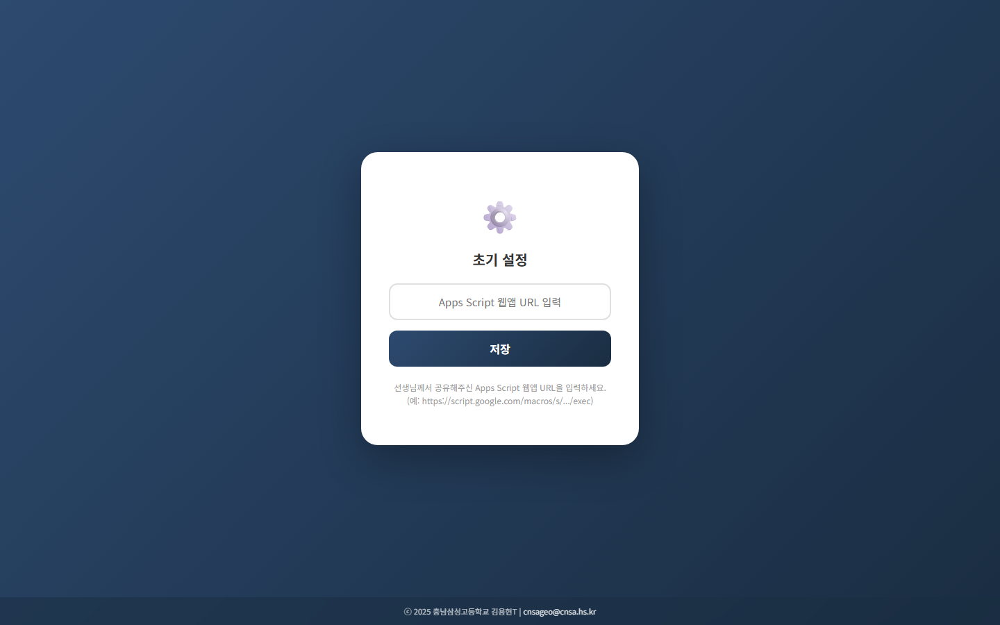

# 워드 클라우드 학생 참여 페이지 (wordcloud4student)

수업 중 학생들이 휴대폰으로 단어를 보내 워드 클라우드를 함께 만드는 활동에서, 학생이 여는 참여 페이지입니다. 단어를 모으고 워드 클라우드를 그리는 쪽은 선생님이 만든 Google Apps Script 웹앱이고, 이 레포에는 학생용 화면만 들어 있습니다.

바로가기: https://yhk1m.github.io/wordcloud4student/



## 할 수 있는 일

- **처음 설정**: 선생님이 알려 준 Apps Script 웹앱 주소(`https://script.google.com/...`)를 넣으면 브라우저에 저장해 두고 다음부터 다시 묻지 않습니다.
- **주소로 바로 연결**: 페이지 주소에 `?api=<웹앱 주소>&code=<세션 코드>`를 붙여 나눠 주면 설정 없이 바로 그 세션에 들어갑니다.
- **세션 확인**: 선생님이 세션을 열었는지 확인하고, 열린 세션이 없으면 대기 화면을 보여 줍니다. 10초마다 다시 확인합니다.
- **단어 보내기**: 한 번에 20자까지 단어를 보내고, 내가 보낸 단어를 화면 아래에 모아 보여 줍니다.
- **연결 오류 안내**: 웹앱에 닿지 못하면 오류 화면과 다시 시도 버튼을 보여 줍니다.

## 여는 법

1. 선생님이 Apps Script 웹앱을 배포하고 세션을 엽니다(웹앱 코드는 이 레포에 없습니다).
2. 학생은 바로가기 주소로 들어가 웹앱 주소를 넣거나, 선생님이 나눠 준 `?api=...&code=...` 주소로 바로 들어갑니다.
3. 단어를 입력하고 제출하기를 누릅니다.

웹앱과는 JSONP 방식(`action=getSessionInfo`, `action=submitWord`)으로 주고받습니다. GitHub Pages가 기본 브랜치(`main`)의 파일을 그대로 보여 줍니다.

## 파일 구성

```
wordcloud4student/
├── index.html      # 학생 참여 페이지 전체 (HTML, CSS, JavaScript 한 파일)
└── docs/images/    # README 그림
```

## 만든 사람

양정고등학교 지리교사 김용현  
문의: bgnlkim@gmail.com
